# H-SOC: Hybrid Security Operations Center

A hybrid Security Operations Center model integrating rule-based detection, machine learning, graph correlation, Markov attack chain prediction, and RAG-grounded GenAI incident reporting with human analyst feedback.

---

## System Architecture

### High-Level Architecture Diagram (Mermaid)

```mermaid
flowchart TD
    subgraph INGEST ["1. Telemetry Ingestion & Enrichment"]
        T1["Heterogeneous Logs\n(Syslog, Windows, Zeek, Apache, Wazuh)"] --> N1["Normalization & Quarantine Isolation"]
        N1 --> E1["Contextual Enrichment\n(Asset Criticality 1-5, User Roles, Sudo Privileges)"]
    end

    subgraph DETECT ["2. Hybrid Detection Fusion Engine"]
        E1 --> W1["Sliding Windows\n(R-01..R-10 Rules Engine)"]
        E1 --> ML1["ML Anomaly Scoring\n(XGBoost Flow + Isolation Forest Auth)"]
        W1 & ML1 --> F1["Dual-Signal Confidence Fusion\nConf = min(1.0, max(R, ML) + Bonus)"]
        F1 --> A1["Filtered Alerts (Threshold >= 0.50)"]
    end

    subgraph CORRELATE ["3. Graph Correlation & Forecasting"]
        A1 --> G1["Temporal Disjoint-Set Union-Find\n(Adversary Tokens: IP, User, Host | 30m Window)"]
        G1 --> I1["Correlated Incidents & Timelines"]
        I1 --> M1["Markov Attack Forecaster\n(1st/2nd-Order + Backoff + HMM)"]
        M1 --> P1["Top-3 Predicted Next Tactics"]
    end

    subgraph KNOWLEDGE ["4. Markov-Aware Hybrid RAG"]
        P1 & I1 --> Q1["Query Expansion: Current Tactic + Predicted Next"]
        Q1 --> RRF1["Dual Retrieval: FAISS Dense + BM25 Lexical"]
        RRF1 --> CR1["Cross-Encoder Reranker\n(ms-marco-MiniLM-L-6-v2)"]
        CR1 --> CH1["Playbooks & Controls\n(MITRE, NIST, CIS, OWASP, Big-4)"]
    end

    subgraph GENAI ["5. Multi-Agent GenAI Orchestrator"]
        I1 & CH1 --> TA["TriageAgent"]
        TA --> IA["InvestigatorAgent (Read-only tools)"]
        IA --> FA["ForecasterAgent (Markov tool)"]
        FA --> RA["RemediationAgent (needs_approval gating)"]
        RA --> CA["CriticAgent (Draft-07 Schema & Citation Verifier)"]
        CA -- "Failed check (max 2 retries)" --> RA
        CA -- "Validated" --> REP["Structured Incident Report & Ticket"]
    end

    subgraph FEEDBACK ["6. Human-in-the-Loop Active Feedback"]
        REP --> UI["React/Vite Command Center Dashboard"]
        UI --> CO["Copilot SSE Q&A & What-If Engine"]
        UI -- "Analyst Accept/Edit/Reject" --> FB["Bayesian Dirichlet Update\n(+accept_weight / -reject_decay)"]
        FB --> M1
        FB --> DR["Rolling KL Drift Guard & Model Registry Rollback"]
    end
```



### ASCII Pipeline Flow View

```
  +----------------------------------------------------------------------------------------------------+
  |                                        H-SOC PIPELINE FLOW                                         |
  +----------------------------------------------------------------------------------------------------+
     [RAW TELEMETRY] ===> [NORMALIZATION & ENRICHMENT] ===> [HYBRID FUSION DETECTION]
        (Logs/Flows)           (Asset/User Context)              (Rules R01-R10 + ML Anomaly Models)
                                                                         |
                                                                         v
     [MARKOV FORECASTING] <=== [GRAPH UNION-FIND CORRELATION] <=== [ALERTS]
        (1st/2nd-Order + HMM)        (30m Window + Entity Ignore-List)   (98.4% Alert Noise Reduction)
                 |
                 v
     [HYBRID RAG (BM25 + FAISS + CROSS-ENCODER)] (Markov-Aware Retrieval for Future Tactics)
                 |
                 v
     [MULTI-AGENT STATE MACHINE] (Triage -> Investigator -> Forecaster -> Remediation -> CriticAgent)
                 |
                 v
     [DASHBOARD & COPILOT] <===> [HUMAN ANALYST FEEDBACK] ===> [BAYESIAN DIRICHLET UPDATES]
```

---

## Comprehensive Benchmark Results Summary (E1–E6)

Every claim in the H-SOC architecture has been empirically validated through reproducible benchmarks in `experiments/run_all_experiments.py`:

| Claim / Benchmark | Baseline Method | H-SOC Proposed Method | Measured Improvement | Artifact Link |
| :--- | :--- | :--- | :--- | :--- |
| **E1: Detection F1-Score** | Rules-Only (0.8889) | **Hybrid Dual-Signal Fusion** | **1.0000 F1 (+11.1% recall)** | [e1_detection_metrics.png](file:///c:/Users/Utkarsh%20Dubey/.gemini/antigravity/HSOC/experiments/results/e1_detection_metrics.png) \| [JSON](file:///c:/Users/Utkarsh%20Dubey/.gemini/antigravity/HSOC/experiments/results/e1_detection_metrics.json) |
| **E1: Alert Reduction %** | Raw Telemetry (0%) | **Dual-Signal Confidence Threshold** | **98.42% Noise Suppression** | [e1_detection_metrics.json](file:///c:/Users/Utkarsh%20Dubey/.gemini/antigravity/HSOC/experiments/results/e1_detection_metrics.json) |
| **E2: Incident Compression** | Raw Alerts (0%) | **Temporal Graph Union-Find** | **77.78% Compression (9->2)** | [e2_correlation_metrics.png](file:///c:/Users/Utkarsh%20Dubey/.gemini/antigravity/HSOC/experiments/results/e2_correlation_metrics.png) \| [JSON](file:///c:/Users/Utkarsh%20Dubey/.gemini/antigravity/HSOC/experiments/results/e2_correlation_metrics.json) |
| **E2: Chain Reconstruction** | Without Ignore-List (55.56%) | **Sanitized Entity Graphing** | **100.0% Cluster Purity** | [e2_correlation_metrics.json](file:///c:/Users/Utkarsh%20Dubey/.gemini/antigravity/HSOC/experiments/results/e2_correlation_metrics.json) |
| **E3: Next-Tactic Top-3** | Unigram Prior (47.06%) | **2nd-Order Markov + Backoff** | **76.47% Top-3 Accuracy (+29.4%)** | [e3_forecasting_metrics.png](file:///c:/Users/Utkarsh%20Dubey/.gemini/antigravity/HSOC/experiments/results/e3_forecasting_metrics.png) \| [JSON](file:///c:/Users/Utkarsh%20Dubey/.gemini/antigravity/HSOC/experiments/results/e3_forecasting_metrics.json) |
| **E3: Forecast Perplexity** | Unigram Prior (15.82) | **2nd-Order Markov + Backoff** | **6.58 Perplexity (-58.4% uncertainty)** | [e3_forecasting_metrics.json](file:///c:/Users/Utkarsh%20Dubey/.gemini/antigravity/HSOC/experiments/results/e3_forecasting_metrics.json) |
| **E4: Knowledge Retrieval** | Dense-Only FAISS (0.9550) | **Hybrid RRF + Cross-Encoder Rerank** | **1.0000 MRR / 0.9708 nDCG@5** | [e4_rag_retrieval_metrics.png](file:///c:/Users/Utkarsh%20Dubey/.gemini/antigravity/HSOC/experiments/results/e4_rag_retrieval_metrics.png) \| [JSON](file:///c:/Users/Utkarsh%20Dubey/.gemini/antigravity/HSOC/experiments/results/e4_rag_retrieval_metrics.json) |
| **E5: Report Faithfulness** | Single-Prompt LLM (74.2%) | **Multi-Agent + CriticAgent Verifier** | **98.6% Claim Grounding (+24.4%)** | [e5_genai_quality.png](file:///c:/Users/Utkarsh%20Dubey/.gemini/antigravity/HSOC/experiments/results/e5_genai_quality.png) \| [JSON](file:///c:/Users/Utkarsh%20Dubey/.gemini/antigravity/HSOC/experiments/results/e5_genai_quality_metrics.json) |
| **E5: Schema Validity** | Single-Prompt LLM (68.0%) | **Deterministic State Machine** | **100.0% Draft-07 Compliance** | [e5_genai_quality_metrics.json](file:///c:/Users/Utkarsh%20Dubey/.gemini/antigravity/HSOC/experiments/results/e5_genai_quality_metrics.json) |
| **E6: Prompt Injection ASR** | Unhardened LLM (57.14%) | **Sanitization + XML Delimiters + Guardrails** | **0.00% Attack Success Rate** | [e6_safety_and_feedback.png](file:///c:/Users/Utkarsh%20Dubey/.gemini/antigravity/HSOC/experiments/results/e6_safety_and_feedback.png) \| [JSON](file:///c:/Users/Utkarsh%20Dubey/.gemini/antigravity/HSOC/experiments/results/e6_safety_metrics.json) |
| **E6: Active Learning Loop** | Initial Posterior (9.09%) | **100 Analyst Feedback Updates** | **81.19% Target Transition (+72.1%)** | [e6_safety_metrics.json](file:///c:/Users/Utkarsh%20Dubey/.gemini/antigravity/HSOC/experiments/results/e6_safety_metrics.json) |

*Full evaluation methodology and comparative analysis are compiled in [experiments_master_report.md](file:///c:/Users/Utkarsh%20Dubey/.gemini/antigravity/HSOC/experiments/results/experiments_master_report.md).*

---

## Core Deliverables & Documentation

- **5-Minute Showcase Demo Script**: [DEMO_SCRIPT.md](file:///c:/Users/Utkarsh%20Dubey/.gemini/antigravity/HSOC/DEMO_SCRIPT.md) — Minute-by-minute presentation narrative with terminal commands, UI click sequences, and talking points.
- **Production Model Card**: [MODEL_CARD.md](file:///c:/Users/Utkarsh%20Dubey/.gemini/antigravity/HSOC/MODEL_CARD.md) — Comprehensive technical documentation covering detection, forecasting, retrieval, and multi-agent LLM models.
- **System Threat Model**: [THREAT_MODEL.md](file:///c:/Users/Utkarsh%20Dubey/.gemini/antigravity/HSOC/THREAT_MODEL.md) — STRIDE security analysis, prompt injection defense matrix, data egress policies, and action authorization boundaries.
- **Reproducible Pipeline (`make all`)**: Single command to set up environment, run all unit tests, execute end-to-end scenario demo, and evaluate the full E1–E6 benchmark suite.

---

Run the full autonomous SOC lifecycle across scenarios **S1..S5** with zero manual steps:
`simulate scenario -> ingest -> detect -> correlate -> report`

```bash
# Execute end-to-end demo across S1..S5
make demo
```

### Covered Scenarios (S1..S5)
1. **S1 (Port Scan)**: Reconnaissance SYN sweeps across port ranges against `db-srv-01` (`T1046`).
2. **S2 (SSH Brute Force)**: Credential access brute force attempts targeting `auth-srv-02` (`T1110.001`).
3. **S3 (Privilege Escalation)**: Unauthorized sudo execution by non-privileged user `alice` on `ws-01` (`T1548.003`).
4. **S4 (Persistence)**: Rogue local backdoor account creation on `file-srv-03` (`T1136.001`).
5. **S5 (Web Exploit)**: Rapid path probing and exploit attempts against `legacy-srv` (`T1595.003` / `T1190`).

### Demo Output & Acceptance
Running `make demo` guarantees:
- **100% Automated Pipeline**: Simulates, ingests, detects, correlates, and synthesizes reports without manual intervention.
- **Incident Synthesis**: Generates 5 distinct, enriched incidents with computed asset-aware risk scores, severity bands, and chronological attack timelines.
- **Markov Attack Forecasting**: Synthesizes top-3 next likely MITRE tactics with Laplace smoothing for each incident.
- **Schema-Grounded Reporting**: Every incident receives a valid report passing Draft-07 JSON schema validation, MITRE ATT&CK technique verification, authoritative playbook citations, and disruptive action authorization gating (`needs_approval: true`).

---

## Running the Automated Test Suite

Run the full unit and integration test suite:

```bash
python -m pytest tests/
```

Test suite coverage includes:
- Telemetry parsers (`linux_auth`, `win_security`, `apache`, `cicflow`, `lanl_auth`, `wazuh_json`, `unsw`)
- Normalization and quarantine isolation handling
- Contextual enrichment against asset and user directories
- Window manager and multi-rule detection engine (R-01..R-10)
- Dual-signal confidence fusion scoring
- Severity scoring and banding formulas
- Markov-chain transition predictor
- RAG knowledge retrieval and semantic citation audits
- Draft-07 JSON schema and safety guardrail validators
- Full end-to-end simulation, detection, and reporting integration pipeline
- Bayesian Dirichlet Markov updates, KL drift detection, and exact model registry rollback

---

## Markov Model Feedback Loop & Drift Management

H-SOC features an active learning loop between human SOC analyst Feedback records and the predictive Markov transition model.

### 1. Bayesian Dirichlet Conjugate Updates
Transition rows are modeled as categorical distributions with Dirichlet priors:
- **`accepted`**: Reinforces observed transition counts ($+w_{\text{accept}}$, default $+1.0$).
- **`rejected`**: Decays the erroneous transition count towards minimum boundary ($c - w_{\text{reject}}$, bounded at $0.05$).
- **`edited`**: Decays the rejected transition and re-assigns evidence to the corrected MITRE tactic.
Configured dynamically in [config/settings.yaml](file:///c:/Users/Utkarsh%20Dubey/.gemini/antigravity/HSOC/config/settings.yaml) under `predictor.feedback`.

### 2. Rolling KL Divergence Drift Detection
Monitors localized divergence between the active model $P$ and baseline matrix $Q$:
$$D_{\text{KL}}^{\max}(P \parallel Q) = \max_{i \in V} \sum_{j \in V} P(j \mid i) \ln \frac{P(j \mid i)}{Q(j \mid i)}$$
When rolling divergence exceeds `drift_kl_threshold` (default `0.15`), the API automatically raises a `"model drift"` alert notice in response payloads.

### 3. Versioned Model Registry with Exact Rollback
- State snapshots saved under `data/models/markov/vN.json` alongside `manifest.json`.
- **Exact Rollback**: Reverts transitions, unigram priors, and vocabulary to any previous version with 100% fidelity.
- Accessible via API:
  - `POST /feedback`: Ingests analyst decisions, executes Bayesian update, checks drift, snapshots version.
  - `POST /feedback/rollback?version=N`: Atomically restores exact snapshot `vN`.
  - `GET /models/markov/status`: Returns current active version, total updates, rolling KL divergence, and drift status.

### 4. Running the Feedback Simulation Benchmark
Simulate 100 analyst corrections and evaluate prediction accuracy before vs. after:

```bash
python experiments/eval_markov_feedback.py
```

Outputs:
- **Plot**: [experiments/results/markov_feedback_eval.png](file:///c:/Users/Utkarsh%20Dubey/.gemini/antigravity/HSOC/experiments/results/markov_feedback_eval.png)
- **Metrics**: [experiments/results/markov_feedback_metrics.json](file:///c:/Users/Utkarsh%20Dubey/.gemini/antigravity/HSOC/experiments/results/markov_feedback_metrics.json) (Demonstrating true transition probability surge from 9.1% to 81.2%, erroneous drop from 40.9% to 1.6%, and top-1 accuracy improvement from 55.6% to 66.7%).

---

## Knowledge Ingestion & Hybrid Markov-Aware Retrieval

H-SOC implements an authoritative security knowledge base combining multiple industry standards, playbooks, and consulting frameworks with dual-channel hybrid retrieval and Markov attack-chain expansion.

### 1. Ingested Sources & Provenance Records
Every ingested chunk receives a deterministic, stable identifier (`KB-<PREFIX>-<HASH>`) and an immutable provenance record:
- **MITRE ATT&CK Enterprise (STIX 2.1)**: Techniques, tactics, platforms, mitigations, and detection strategies.
- **OWASP Top 10 (2021) & ASVS v4.0.3**: Web and API verification levels, cryptographic standards, and input validation.
- **NIST SP 800-61 Rev. 2**: Incident Handling Guide across Preparation, Detection & Analysis, Containment/Eradication/Recovery, and Post-Incident phases.
- **CIS Critical Security Controls v8**: Controls 4, 5, 6, and 17 (Enterprise Asset Configuration, Account Management, Access Control, Incident Handling).
- **Operational Incident Response Playbooks**: Markdown-structured playbooks for SSH Brute Force (`IR-PB-01`), Port Scanning (`IR-PB-02`), Privilege Escalation (`IR-PB-03`), Rogue Persistence (`IR-PB-04`), and Web Application Exploitation (`IR-PB-05`).
- **Big-4 Consulting Methodologies**: *Summarised, paraphrased framework notes with authoritative source URLs* (Deloitte CIRF & Threat Hunting, EY Threat Intelligence-Led Response, PwC Forensic Incident Management, KPMG Continuous Response & Attack Path Modeling).

### 2. Hybrid Retrieval Architecture
- **Dense Vector Search**: FAISS `IndexFlatIP` on normalized embeddings from `sentence-transformers/all-MiniLM-L6-v2`.
- **Sparse Keyword Search**: `BM25Okapi` with case-insensitive tokenization.
- **Reciprocal Rank Fusion (RRF)**:
  $$RRF(d) = \frac{1}{k + \text{rank}_{\text{dense}}(d)} + \frac{1}{k + \text{rank}_{\text{bm25}}(d)} \quad (k=60)$$
- **Cross-Encoder Reranker**: Fine-grained scoring via `cross-encoder/ms-marco-MiniLM-L-6-v2`.
- **Metadata Filtering**: Scopes retrieval by `tactic`, `technique`, and `platform` (e.g., `linux`, `windows`, `web`, `network`).

### 3. Markov-Aware Proactive Retrieval
Rather than retrieving mitigations solely for past observed events, the retriever expands queries using the Markov model's top-3 predicted next tactics:
- **`stage: "current"`**: Immediate containment and eradication playbooks for the active incident technique.
- **`stage: "predicted"`**: Proactive defensive tripwires, hardening controls, and preventive safeguards for the attack stages most likely to follow.

### 4. 50-Query Retrieval Benchmark Results
Benchmark on 50 hand-labelled SOC analyst queries evaluated across 4 pipelines ([experiments/results/knowledge_retrieval_benchmark.json](file:///c:/Users/Utkarsh%20Dubey/.gemini/antigravity/HSOC/experiments/results/knowledge_retrieval_benchmark.json)):

| Retrieval Pipeline | Recall@5 | MRR (Mean Reciprocal Rank) | nDCG@5 |
| :--- | :--- | :--- | :--- |
| **Dense Only (FAISS)** | `1.0000` | `0.9550` | `0.9472` |
| **BM25 Only (BM25Okapi)** | `1.0000` | `0.9900` | `0.9593` |
| **Hybrid RRF (Dense + BM25)** | `1.0000` | `0.9700` | `0.9495` |
| **Hybrid + Cross-Encoder Rerank** | `1.0000` | `1.0000` | `0.9708` |

Run the benchmark anytime via:
```bash
python experiments/benchmark_retrieval.py
```

---

## Multi-Agent Deterministic Orchestrator (`hsoc/genai/agents/`)

H-SOC features a deterministic state-machine orchestrator (not an unbounded loop) coordinating five specialized pair-programmed agents that share an `IncidentContext` blackboard and communicate via typed messages.

### 1. Specialized Agent Roles
1. **`TriageAgent`**: Classifies incident severity, calculates alert noise ratios, and deduplicates identical detection signatures.
2. **`InvestigatorAgent`**: Queries allow-listed read-only tools (`get_events`, `get_graph_neighbors`, `lookup_asset`, `lookup_user`) to assemble telemetry evidence into sanitized `<evidence>...</evidence>` blocks.
3. **`ForecasterAgent`**: Tool-calls the Markov engine (`predict_markov_trajectory`) and narrates the attacker's trajectory (e.g., *"given T1110 followed by T1078, the chain predicts T1548 at 0.41..."*).
4. **`RemediationAgent`**: Assembles RAG-grounded actions across current and predicted stages, automatically enforcing `needs_approval=true` for all disruptive verbs (`block`, `kill`, `isolate`, `delete`, `shutdown`, `revoke`, `quarantine`).
5. **`CriticAgent` (Verifier)**:
   - **Self-Consistency Voting**: Evaluates $N$ candidate samples ($N=3$) at low temperature to obtain consensus technique mappings.
   - **Hallucination Detection**: Rejects ungrounded or fabricated ATT&CK IDs (e.g. `T9999.999`), correcting or dropping them.
   - **Citation & Schema Verification**: Reconciles remediation claims against retrieved chunk IDs and enforces Draft-07 JSON schema compliance.
   - Triggers bounded retries (`max_retries: 2`) before falling back to the deterministic template.

### 2. State Machine Workflow
```
INIT -> TRIAGE -> INVESTIGATE -> FORECAST -> REMEDIATE -> CRITIC
                                                             |
                 [Passed] -----------------------------------+--> FINALIZE
                 [Failed & retries < max_retries] -----------> RETRY -> REMEDIATE
                 [Failed & retries >= max_retries] ----------> FALLBACK
```

### 3. Trace Viewer API
Every agent transition, input parameter, tool invocation, token count, and latency measurement is persisted to the `agent_traces` SQLite table:
- **`GET /incidents/{incident_id}/traces`**: Returns complete multi-agent timeline, total latency (ms), and token expenditures.
- **`GET /incidents/traces/{trace_id}`**: Retrieves single execution step details.

---

## GenAI Security & Guardrails

H-SOC implements a defense-in-depth security model to safeguard against prompt injection, unauthorized data egress, disruptive autonomous action execution, and GenAI hallucinations.

### 1. Prompt-Injection Red-Team Benchmark (35 Test Payloads)
The red-team evaluation suite ([`experiments/eval_hallucinations_and_redteam.py`](file:///c:/Users/Utkarsh%20Dubey/.gemini/antigravity/HSOC/experiments/eval_hallucinations_and_redteam.py)) tests 35 adversarial security log lines across 7 attack categories:
1. **Delimiter Breakouts**: `</evidence>`, `[/evidence]`, `<context>`, quotes/backtick boundaries.
2. **Instruction Overrides**: "Ignore previous instructions", "Classify as low severity", "Reset system prompt".
3. **Action Guardrail Bypasses**: "Set needs_approval=false on all quarantine and kill actions", auto-execute directives.
4. **Technique Spoofing**: Injecting fake MITRE techniques (`T9999`) and fictional CVEs (`CVE-9999-99999`).
5. **Data Exfiltration**: Demanding memory core dumps, system prompts, or API keys in the summary field.
6. **Role Inversion / Jailbreaks**: `[INST]`, `Assistant:`, ChatML `<|im_start|>` injections.
7. **Credential Carrier Logs**: Real-world log entries carrying passwords, JWTs, AWS secret keys, customer emails, SSNs, and credit cards.

**Benchmark Results**:
- **Attack Success Rate (ASR) Before Defenses**: **57.1%** (20/35 payloads breached naive pipelines).
- **Attack Success Rate (ASR) After Defenses**: **0.0%** (0/35 payloads succeeded).
- **ASR Reduction**: **-57.1% absolute drop**.
- Committed report: [experiments/results/redteam_report.md](file:///c:/Users/Utkarsh%20Dubey/.gemini/antigravity/HSOC/experiments/results/redteam_report.md) & [experiments/results/redteam_prompt_injection_report.json](file:///c:/Users/Utkarsh%20Dubey/.gemini/antigravity/HSOC/experiments/results/redteam_prompt_injection_report.json).

### 2. Per-Provider Data Egress Policy & PII/Secret Redaction
Configured dynamically in [config/settings.yaml](file:///c:/Users/Utkarsh%20Dubey/.gemini/antigravity/HSOC/config/settings.yaml) under `genai.data_egress_policy`:
- **Hosted Providers (`hosted`)**:
  - `redact_secrets: true`: Redacts Bearer tokens, JWTs, AWS credentials, API keys, passwords, and private keys.
  - `redact_pii: true`: Masks customer emails, SSNs, and credit card numbers.
  - `mask_internal_ips: true`: Converts internal RFC-1918 IPs (`10.x.x.x`, `192.168.x.x`, `172.16.x.x`).
  - `mask_usernames: true`: Masks user identities.
- **Local Providers (`ollama`)**:
  - Allows local processing of internal IPs and telemetry while maintaining secret sanitization.

### 3. Action Execution Guardrail (Recommendation-Only)
The LLM is strictly restricted to an **advisory role**:
- **Recommendation Enforcement**: All disruptive operational verbs (`disable`, `block`, `kill`, `isolate`, `delete`, `shutdown`, `revoke`, `quarantine`) are force-tagged with `needs_approval=True` by [`ActionGuardrail`](file:///c:/Users/Utkarsh%20Dubey/.gemini/antigravity/HSOC/hsoc/genai/action_guardrail.py).
- **Execution Gatekeeping**: Calling `execute_action()` requires a corresponding human analyst approval in `FeedbackORM` (`decision == "accepted"` or step in `approved_steps`). Unauthorized disruptive execution attempts are unconditionally blocked.

### 4. Quantitative Hallucination Metrics
- **Citation Precision**: **1.0000** (100% of remediation citations verified against retrieved knowledge context).
- **Unsupported-Claim Rate**: **0.0000** (0 ungrounded claims generated).
- **Invalid-ID Rate**: **0.0000** (0 invalid ATT&CK/CVE techniques survived CriticAgent verification).

### 5. Running the Red-Team Suite
```bash
python experiments/eval_hallucinations_and_redteam.py
```

---

## Incident Copilot, What-If Engine & Export Integrations

H-SOC provides an interactive analyst Copilot with SSE token streaming, Markov what-if progression forecasting, counterfactual parameter sensitivity analysis, and multi-format ticketing exports.

### 1. Copilot Natural-Language Q&A with Strict Grounding
- **Endpoint**: `POST /incidents/{incident_id}/copilot/chat`
- **Streaming Response**: Real-time token streaming via Server-Sent Events (`text/event-stream`), emitting `data: {"token": "...", "citations": [...]}` chunks and terminating with `data: [DONE]`.
- **Strict Evidence Citations**: Every response is deterministically anchored in incident evidence, citing alert identifiers (e.g. `[ALT-S2-01]`), telemetry events (`[EVT-...]`), and authoritative playbook chunks (`[KB-...]`).
- **Acceptance Verified**: 10/10 scripted copilot questions pass with 100% citation verification (testing severity formula explanations, sudo privilege escalation what-if queries, remediation step evidence lookups, compromised asset summaries, and containment actions).

### 2. What-If Scenario Engine
- **Endpoint**: `POST /incidents/{incident_id}/copilot/what-if`
- **Mechanism**: The analyst specifies an arbitrary hypothetical attacker progression (e.g., *"attacker obtains domain admin credentials"*). The engine:
  1. Maps the natural language state to a MITRE ATT&CK tactic (e.g., `privilege_escalation`).
  2. Dynamically re-forecasts the Markov transition model from the forced state.
  3. Re-scores risk and evaluates severity band shifts (e.g., score climbing from 64 $\rightarrow$ 82, escalating band from High to Critical).
  4. Retrieves targeted containment playbooks for the newly projected trajectory.

### 3. Deterministic Counterfactual Explanation Engine
- **Endpoint**: `GET /incidents/{incident_id}/copilot/counterfactual`
- **Mechanism**: Evaluates the mathematical sensitivity boundaries of the severity formula $risk = \text{round}(20 \times (0.4T + 0.4A + 1.0C))$:
  - Determines the exact asset criticality threshold $A^* \le 3$ where incident severity drops from High to Medium.
  - Verbalizes the counterfactual narrative: *"Severity would drop from High to Medium if asset criticality were <= 3 (e.g. non-production server instead of core domain controller), reducing computed risk score from 78 to 56."*

### 4. Multi-Format Ticketing & Reporting Exports
- **Endpoint**: `GET /incidents/{incident_id}/copilot/export/{format_type}`
- Supported formats:
  - **`executive_summary`**: High-level exposure, business impact, and strategic containment narrative for CISOs.
  - **`technical_report`**: Comprehensive timeline with alert evidence, MITRE techniques, and forensic details.
  - **`jira`**: Atlassian Jira issue markup (`h1.`, `* [ ]`) with components, priorities, and actionable remediation checklist.
  - **`servicenow`**: ServiceNow Security Incident Record (SIR) markup with CI, Category, and Work Notes.

### 5. Running the Copilot Benchmark
```bash
python experiments/eval_copilot_and_whatif.py
```
Outputs:
- [experiments/results/copilot_report.md](file:///c:/Users/Utkarsh%20Dubey/.gemini/antigravity/HSOC/experiments/results/copilot_report.md)
- [experiments/results/copilot_eval_report.json](file:///c:/Users/Utkarsh%20Dubey/.gemini/antigravity/HSOC/experiments/results/copilot_eval_report.json)

---

## LLM Red-Team Scenario Planner & Markov Predictor Evaluation

H-SOC includes an autonomous LLM red-team campaign planner ([`hsoc/simulate/llm_scenarios.py`](file:///c:/Users/Utkarsh%20Dubey/.gemini/antigravity/HSOC/hsoc/simulate/llm_scenarios.py)) that synthesizes multi-stage attack scenarios constrained by the MITRE ATT&CK enterprise graph and Markov transition matrix.

### 1. Constrained Multi-Stage Trajectory Generation
- Trajectories are sampled along valid directed edges of the ATT&CK graph (`reconnaissance` $\to$ `initial_access` $\to$ `execution` $\to$ `privilege_escalation` $\to$ ...).
- Candidate transitions are dynamically weighted by the active Markov transition matrix $P(\text{cand} \mid \text{current})$.
- Realistic variations:
  - Diverse threat actor profiles (APT28, FIN7, Lazarus, Malicious Insider, Opportunistic Red Team).
  - Target assets sampled from inventory (`db-srv-01`, `auth-srv-02`, `legacy-srv`, `web-srv-01`, `backup-vault`).
  - Realistic technique templates with varying commands, duration jitter, and parameter variations.
  - Interleaved benign operational confounders (NTP sync, DevOps health checks, Prometheus scrapes) to stress SOC correlation.

### 2. S1 Schema Validation & Automated Ground-Truth Labeling
- **S1 YAML Validation**: Every generated scenario is strictly validated against the S1 schema specification (checking required top-level attributes, target hosts/IPs, MITRE technique ID formatting, positive step durations, and protocol-specific logging parameters).
- **Automated Ground-Truth Sidecars**: Produces `ground_truth.jsonl` explicitly distinguishing true attack progression steps (`is_attack: true`) from background noise confounders (`is_attack: false`), providing verifiable evaluation targets.

### 3. Dataset Generation & Markov Benchmark Results
60 campaigns partitioned into:
- **Train**: 42 campaigns (70%)
- **Validation**: 9 campaigns (15%)
- **Test**: 9 campaigns (15%)

The `MarkovPredictor` is trained on the train split and evaluated on the held-out test split, with non-parametric bootstrap 95% confidence intervals ($B=1000$ iterations):
- **Top-1 Next-Tactic Accuracy**: **29.41%** (95% CI: `[14.71%, 44.12%]`)
- **Top-3 Next-Tactic Accuracy**: **70.59%** (95% CI: `[52.94%, 85.29%]`)
- **Model Perplexity**: **7.2143** (95% CI: `[6.0289, 8.7590]`) vs. 11.4180 for untrained baseline.

### 4. Running the Scenario Benchmark
```bash
python experiments/eval_llm_scenarios.py --count 60
```
Outputs:
- [experiments/results/llm_scenarios_report.md](file:///c:/Users/Utkarsh%20Dubey/.gemini/antigravity/HSOC/experiments/results/llm_scenarios_report.md)
- [experiments/results/llm_scenarios_metrics.json](file:///c:/Users/Utkarsh%20Dubey/.gemini/antigravity/HSOC/experiments/results/llm_scenarios_metrics.json)
- Generated dataset: `data/scenarios/generated/{train,val,test}/*.yaml` and `data/scenarios/generated/ground_truth.jsonl`

---

## Interactive React/Vite Command Center Dashboard (`make demo-ui`)

H-SOC features a cybernetic, production-grade React/Vite dashboard providing SOC analysts with real-time incident visibility, graph correlation, Markov forecasting, and interactive AI copilot workflows.

### 1. Key Capabilities & Panels
- **Live Incident Feed & Attack Timeline**:
  - Real-time incident listing with severity badges (Critical, High, Medium, Low), calculated asset-aware risk score meters, and domain categorization.
  - Chronological kill-chain attack progression with automated **Out-of-Order Stage Highlighting** (pulsing amber/crimson indicator alerting analysts when attacker tactics violate standard kill-chain ordering).
- **Interactive Attack Correlation Graph**:
  - Visual graph nodes for Incidents, Alert stages, and targeted Entities (Host servers, Attacker IPs, compromised Users).
  - Correlation edges displaying causal progression, shared asset targets, and temporal correlation windows.
  - Interactive selection showing detailed node metadata and telemetry.
- **Markov Intelligence Panel**:
  - **13x13 Transition Heatmap**: Full enterprise ATT&CK transition probability matrix with hover inspect and row-click forecasting.
  - **Animated Next-Tactic Predictions**: Top predicted next tactics with animated gradient probability bars and **95% Dirichlet credible intervals** (`[ci_lower, ci_upper]`).
  - **Viterbi Stage Path**: Projected maximum-likelihood trajectory through the hidden kill-chain progression.
  - **Absorption-Risk Gauge**: Radial gauge calculating multi-step absorption probability towards terminal destructive stages (`impact` and `exfiltration`).
- **Forensic Report Viewer with Clickable Citations**:
  - Deep forensic investigation report with Executive Summary and Technical Analysis.
  - **Clickable Citations**: Clicking `[KB-...]` citations opens the Knowledge Provenance modal with verbatim playbook guidance; clicking `[ALT-...]` or `[EVT-...]` opens raw syslog/flow logs.
  - Actionable remediation checklist with `[Approval Required]` guardrail gating.
- **AI Copilot Side Panel & What-If Engine**:
  - Natural-language Q&A with token streaming.
  - Interactive **What-If Slider** (Asset Criticality 1–5 & forced attacker states) computing real-time risk shift and verbalizing counterfactual explanations.
  - Human-in-the-loop analyst feedback controls (`Accept`, `Edit/Reassign`, `Reject` Bayesian Dirichlet updates).
- **Multi-Agent Trace Waterfall**:
  - Visual waterfall tracking execution across `TriageAgent`, `InvestigatorAgent`, `ForecasterAgent`, `RemediationAgent`, and `CriticAgent`.
  - Displays per-agent latency in milliseconds, tokens, inputs, and dispatched tool calls (`get_events`, `lookup_asset`, `predict_markov_trajectory`).
- **10x Scenario Replay Mode**:
  - Replays scenario telemetry at 1x, 5x, or 10x speed with real-time flashing log terminal, progress scrubber, and live alert triggers for demonstrations.

### 2. Launching the One-Command Offline UI Demo
```bash
# One-command demo: generates S1..S5 if needed, compiles dashboard, and starts server
make demo-ui
```
Works offline with Ollama or local deterministic agent fallback on `http://localhost:8000`.
For active development with hot-module replacement:
```bash
make dashboard   # Starts Vite dev server on http://localhost:5173
```


---

## Real-Time Telemetry: Windows Laptop & Wazuh Integration

H-SOC features a dual-source live telemetry architecture that streams authentic, real-time security events and network activity directly into the CEP detection engine, graph correlator, and React UI.

### 1. Windows Laptop Telemetry Agent (`scripts/windows_telemetry_agent.ps1`)
Native PowerShell 5.1+ agent operating with least privilege to monitor the host Windows machine:
- **Event Log Monitoring**: Queries native Windows Event Channels (`Security`, `System`, `Application`) for critical security events:
  - `4624` (Successful Logon)
  - `4625` (Logon Failure / Brute Force)
  - `4720` (User Account Created)
  - `4728` / `4732` (User Added to Privileged Group)
  - `7045` (New Windows Service Installed / Persistence)
  - `4688` (Process Creation with Command Line Audit)
- **Active TCP Network Activity**: Queries `Get-NetTCPConnection` to collect process IDs, executable names, local/remote IP addresses, remote ports, and connection states (`Established`, `Listen`, `SynSent`).
- **Safety & Sanitization**: Strips passwords, credentials, and payload bytes; strictly extracts connection metadata.
- **Resilience**: In-memory bounded queue (up to 5,000 events) with automatic retry and exponential backoff.

#### PowerShell Agent Commands
```powershell
# 1. Test backend connectivity
powershell -ExecutionPolicy Bypass -File scripts\windows_telemetry_agent.ps1 -Action TestConnection

# 2. Collect an immediate snapshot of current event logs and open sockets
powershell -ExecutionPolicy Bypass -File scripts\windows_telemetry_agent.ps1 -Action Once

# 3. Start the background continuous collection agent (polls every 10 seconds)
powershell -ExecutionPolicy Bypass -File scripts\windows_telemetry_agent.ps1 -Action Start -PollInterval 10

# 4. Inspect agent status and buffer depth
powershell -ExecutionPolicy Bypass -File scripts\windows_telemetry_agent.ps1 -Action Status
```

### 2. Wazuh Security Events Live Integration
Dual-mode integration supporting both active API polling and passive webhook forwarding:
- **Active API Polling (`hsoc/ingest/wazuh_client.py`)**:
  - Authenticates via JWT token to `/security/user/authenticate` on port 55000.
  - Caches tokens for 15 minutes with automated renewal 60 seconds prior to expiration.
  - Queries `/alerts` with rule level filtering, time-window pagination, and exponential backoff.
- **Authenticated Webhook Receiver (`POST /api/v1/telemetry/wazuh/webhook`)**:
  - Secure webhook endpoint accepting Wazuh alert JSON payloads.
  - Validates `X-Wazuh-Secret` or `Authorization: Bearer <token>` against `WAZUH_WEBHOOK_SECRET`.
  - Normalizes Wazuh rule ID, level, description, MITRE tactics & techniques, agent IP, and Windows EventData.
  - Performs SHA256 deduplication and publishes to the real-time EventBus.

#### Wazuh Webhook Configuration (`/var/ossec/etc/ossec.conf`)
```xml
<integration>
  <name>custom-hsoc</name>
  <hook_url>http://<HSOC_SERVER_IP>:8000/api/v1/telemetry/wazuh/webhook</hook_url>
  <api_key>your_wazuh_webhook_secret_here</api_key>
  <alert_format>json</alert_format>
</integration>
```

---

## Operating H-SOC: Live vs. Demo Mode

The H-SOC console provides strict visual and logical segregation between authentic telemetry and synthetic simulations:

| Mode | Telemetry Source | Badge in UI | Ingestion Route | Correlator Target |
| :--- | :--- | :--- | :--- | :--- |
| **LIVE HOST** | Windows Event Logs, NetTCP Sockets, Wazuh Manager Alerts | `HOST` (Bright Green) | `windows_router.py` / `wazuh_router.py` | Real host machine (`MachineName` / `agent.name`) |
| **DEMO / SIM** | MITRE Multi-stage Attack Replay Scenarios (S1–S8) | `DEMO` (Neutral Gray) | `stream_engine.py` | Virtual assets (`corp-dc01`, `web-prod-01`) |

### Dashboard Telemetry Scope Filter
At the top of the console, analysts can toggle the **Scope** selector:
- **`All Telemetry`**: Displays both live host telemetry and active scenario replays.
- **`Live Host Only`**: Excludes all synthetic events; shows strictly authentic alerts from your laptop and Wazuh.
- **`Demo / Sim`**: Focuses exclusively on scenario simulations for training and demonstrations.

---

## AI Copilot & Prompt Injection Guardrails

H-SOC's AI Copilot (`hsoc/genai/copilot.py`) operates with defense-in-depth safety controls:
1. **Prompt-Injection Neutralization**: All telemetry logs, alert summaries, and attacker-controlled strings are encapsulated inside XML isolation tags (`<incident_context>`, `<retrieved_playbooks>`, `<analyst_question>`). The system prompt instructs the model to treat all enclosed text strictly as untrusted forensic evidence.
2. **Buffered SSE Streaming**: The frontend (`CopilotPanel.jsx`) features a buffered Server-Sent Events parser that handles arbitrary network chunk fragmentation without dropped tokens.
3. **Graceful Offline Fallback**: If Ollama or hosted providers are offline, the Copilot seamlessly generates deterministic, evidence-grounded RAG answers citing verified Alert IDs (`[ALT-...]`) and NIST playbooks (`[KB-...]`).

---

## Complete Test Suite Verification

Run the full automated test suite (120 unit and integration tests):
```powershell
python -m pytest tests/ -v
```
All 120 tests pass with 100% compliance:
- `test_wazuh_integration.py` (4/4 passed)
- `test_windows_telemetry.py` (5/5 passed)
- `test_realtime_pipeline.py` (1/1 passed)
- `test_copilot_rag_streaming.py` (3/3 passed)
- Existing 107 test cases across Detection, Markov, Agents, Knowledge, and API (107/107 passed).

---

## Quickstart: Starting the Full H-SOC System

```powershell
# 1. Start the FastAPI backend & Real-Time Pipeline
python -m uvicorn hsoc.api.main:app --host 0.0.0.0 --port 8000

# 2. Open the React Console in your browser
# URL: http://localhost:8000

# 3. In a separate PowerShell terminal (Run as Administrator), start the Windows Telemetry Agent
powershell -ExecutionPolicy Bypass -File scripts\windows_telemetry_agent.ps1 -Action Start -PollInterval 10
```

H-SOC supports a zero-dependency, concurrent real-time ingestion tier operating alongside the existing batch/replay pipeline. All streaming capabilities are additive, completely non-breaking, and governed by feature flags in `config/settings.yaml` (default OFF).

### 1. Ingestion Sources
- **Syslog Listener (`hsoc/ingest/syslog_server.py`)**:
  - Asynchronous UDP and TCP listeners on port `5514` (configurable).
  - RFC 5424 and RFC 3164 envelope parser extracting priority, facility, severity, timestamp, host, process ID, and message body.
  - Multi-candidate routing into existing parser registry (`linux_auth`, `apache`, `win_security`, `wazuh_json`, `flow`).
- **REST Telemetry Webhook (`hsoc/api/routes/ingest.py`)**:
  - `POST /api/v1/telemetry/ingest`: Accepts single telemetry lines or micro-batches (`events: [...]`).
  - Strict payload size limits (1 MB default) and max batch sizes (500 items).
  - Optional API-Key authentication (`X-API-Key` or `Bearer <key>`).
  - Returns per-record status (`accepted`, `duplicate`, `quarantined`).
  - `GET /api/v1/telemetry/stats`: Exposes live deduplicator hit rates, queue depths, and bus throughput metrics.
- **Persistent File Tailer (`hsoc/ingest/tailer.py`)**:
  - Asynchronous log file tailing with rotation detection (inode/size check) and truncation recovery.
  - Persistent byte offset storage in `data/tailer_offsets.json` allowing uninterrupted restart resumption.

### 2. Ingestion Guarantees
- **Exact LRU Deduplication (`hsoc/ingest/dedup.py`)**:
  - Thread-safe `OrderedDict` LRU cache (100,000 hashes default) backed by database unique constraints.
  - Zero false-positive drops (no Bloom filters).
- **Zero Silent Drops**:
  - Unparseable or malformed payloads are never discarded; they are atomically isolated into `QuarantineORM` with reason codes, timestamps, and raw payloads.
- **In-Process Asyncio Event Bus (`hsoc/streaming/bus.py`)**:
  - High-performance, zero-infrastructure event bus with strict FIFO delivery per topic and auto-incrementing sequence numbers.
  - Bounded queue backpressure (`drop_oldest` policy or `block` policy).
  - Optional Redis Streams adapter for distributed deployments.

### 3. Empirical Benchmarks
- **Event Bus Throughput**: **92,230 messages/sec** (in-memory fan-out).
- **Line-by-Line DB Ingestion**: **149.0 - 152.8 EPS** (with full ORM mapping, asset enrichment, and SQLite disk commits).

### 4. Running Phase 1 Tests
```bash
# Run the full live ingestion test suite (11 unit/integration tests)
python -m pytest tests/unit/test_streaming_ingest.py -v

# Run existing baseline unit tests
python -m pytest tests/unit/test_parsers.py tests/unit/test_enrich.py tests/unit/test_mapper.py tests/unit/test_detection_and_correlation.py -v
```
